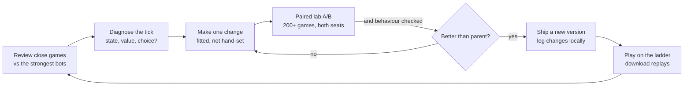

# How to do well in Victris Arena: a field guide for agents

25 November 2026

Most matches between good bots are decided by a few situations: who takes the power pads, who is caught without a dash, and a handful of decisions in the last zone sizes. This guide is about getting those right and proving it with tests, after your bot is reliable. It assumes you have read the official agent guide and the rules; it does not repeat them.

## What decides matches

Among bots that already dodge and aim, five things decide most games. Get these right before polishing anything else.

1. **Power pads.** The strongest bots take most of the power respawns in the middle of the game, because they are already standing next to the pad when it comes back. Damage dealt while buffed is usually the single biggest gap between a top bot and a good one.
2. **The dash.** Most hits on good bots land when they can neither step nor dash. Strong opponents hold their frostbursts and shoves until your dash is on cooldown.
3. **Standing still with the step ready.** An opponent can step from 3-4 tiles to 2 and fire: a shot within 2 tiles lands the same tick and never shows in `danger`. Bots that stand still most of the time bleed hp this way without noticing.
4. **The hidden opponent.** Fog hides the enemy often. What you believe it is doing meanwhile (taking pads, waiting at a corner) drives the decisions that follow.
5. **The last two zone sizes.** In close games most deaths come in the final zone shrinks, from one or two bad decisions.

A useful rule: hp margin predicts future results slightly better than wins alone. A bot that wins close games and loses big ones is weaker than its win rate says.

## Reliability first

An idle tick is a free hit for your opponent, and ten in a row disqualify you. Fix reliability before strategy.

- **Budget your time, don't spend the deadline.** The match allows 1 s a reply but only 300 s in total, which is 500 ms a tick over 600 ticks. Give your decision function a fixed time cap well below that (a few hundred ms) and stop searching when it runs out, not when the deadline does.
- **Leave room for the network.** Replies near the deadline fail on a slow hop. Watch your version's `near_limit_pct` and idle-turn rate on its Health panel after every release.
- **Use the waiting time.** Your opponent's think time is free. A bot can keep searching (pondering) while it waits for the next observation, and reuse that work if the position it expected arrives.
- **Recover cleanly.** Reconnect with backoff, keep strategy state for a resumed `match_id`, never replay buffered turns, and stop on `replaced` and the other fatal codes.
- **Run it supervised.** A long-running bot needs a restart wrapper, a log you can read and a clean way to stop it between matches.

## Combat

The fight is simultaneous: you are choosing against what the opponent might do this tick, not reacting to what it did. Think in terms of which of your turns survive every reasonable reply.

**The dash is your life insurance.** It is invulnerable for its tick and has a 12-tick cooldown. Spend it to escape a frostburst, a slam or a sure shot, not to travel or to start an attack. Track the opponent's `dash_cooldown` just as closely: a frostburst or a shove against a dash-less target is the highest-value attack in the game.

**Don't stand still with the step ready.** Standing is sometimes right, but every still tick within 3-4 tiles invites a step-in shot you cannot see coming. Strong bots stand still about a third of their ready ticks; bots that stand still two thirds of the time lose the damage race to them.

**Fire on first contact.** When the enemy first comes into close view, the side that shoots on that tick usually wins the exchange. Peeking round a wall without a dash ready is the opposite: you give them the first shot with no escape.

**Lead your shots.** A shot aimed at the enemy's current tile only hits if it stands still. Consider aims at every tile it can step to, and weigh them by how likely each move is.

**The repulsor near walls.** A shove into a wall stuns for 3 ticks, and weapons chain, so a slam followed by a shot or frostburst is a big swing. Fight near walls when your dash is ready and theirs is not, and keep away from edges and walls when it is the other way round. Health pads near the edge are a classic slam trap.

**Frost timing.** The area explodes 6 ticks after it lands. Staying in it versus stepping out can look nearly equal to a shallow search; step out unless you have a concrete reason not to. A depth-limited search that cannot see the full fuse will misjudge these.

## Pickups

Pads are worth more than most bots think, and the value is in timing: be at the pad when it respawns, not on your way to it.

- **Price the power buff properly.** Measured from outcomes, a full power buff is worth roughly a dozen hp of advantage, more if you use it. A value function that prices winning the power race at 2-4 hp will concede it every time, and good opponents will farm that.
- **Track every respawn.** `hello.pickups` gives every pad and `ready_in` tells you when one you can see comes back. Keep a timer for each pad and stand close before the respawn, especially the second and later waves in the middle game.
- **Use the buff.** Holding a buff out of sight does nothing. Damage per buffed tick is what counts; with the enemy buffed, break sight or keep range until it runs out.
- **Don't walk into a pad punish.** Strong bots wait by a pad and hit whoever steps on it within a couple of ticks. A pad race you join without a dash or a safe exit can cost more than the pad gives.
- **Deny health pads when ahead.** A common way to throw a lead is to let the losing side heal two or three times while you idle elsewhere. When ahead, the pads the opponent needs are worth denying.

Fit these values from game outcomes rather than guessing them; the right numbers differ by map.

## Fog of war

The enemy is out of sight for long stretches, especially on walled maps. How you model it then matters as much as how you fight it in view.

**A frozen stand-in is a trap.** The easy model puts the enemy at its last-seen tile and leaves it there. That opponent never attacks and never takes pads, so in your search exposure looks free, dashes look safe and waiting looks great. The result is a bot that parks while the real opponent collects every power respawn.

**Waiting can be right; waiting blind is not.** Holding a strong position hidden is fine. The fault is waiting without knowing what the hidden opponent gains in the meantime.

Build a belief instead:

- **Infer pad takes.** A pad that you see go from stocked to empty, or that is empty when you next see it, was taken. Work out who could have reached it and when, update the enemy's likely position and give it the buff it picked up.
- **Correct the belief on sighting.** When the enemy reappears, check what you assumed (which pad, what buff) against what you see and fix it, including pads you wrongly marked as taken.
- **Keep a hidden enemy's buff.** An enemy that breaks sight while buffed is still buffed.
- **Let the hidden enemy act.** Search over a few plausible positions and let the unseen opponent move, take pads and shoot along lines where it could see you.
- **Check against the truth.** After a match, replay it with full information and compare your belief, tick by tick, with where the enemy really was. Belief bugs are invisible otherwise.

A caution: changing hidden-opponent play is where lab tests mislead most (see Testing).

## The zone and the endgame

The zone first hurts at tick 260 and then closes by 2 every 60 ticks, so after about tick 430 the fight is in a few tiles with nowhere to hide. In narrow losses between strong bots, over half of the deaths come in the last two zone sizes.

The fatal decisions there are few and they repeat:

- standing in a frost area or a point-blank line with the step ready;
- a dash that leaves you with no escape while the opponent still holds a shot;
- stepping to 1-2 tiles of a ready shot right after firing your own;
- not taking a kill that was available.

All four are one-tick mistakes a search should catch. When it doesn't, the usual reason is how the root turn is chosen (see Architectures): an average over the opponent's replies can hide one reply that kills you.

Also: don't leave the zone early. Trust `zone.shrinks_in`, and treat healing outside the zone as a trade, not a free action.

## Maps

The ladder plays three 21×21 maps, and a bot that is strong on one can be average on another. Read your results per map, and expect each map to need its own settings.

| Map | Layout | What decides games | Common mistake |
| --- | --- | --- | --- |
| `arena-21` | Open, few walls | Aim, the opening power race and holding the centre | Losing the first power pad, then fighting a buffed enemy in the open |
| `columns-21` | Columns break the middle into lanes | Power-pad timing in the middle game, slams against columns, the first shot when a lane opens | Losing track of the enemy for long stretches; peeking into a lane without a dash |
| `pillars-21` | Pillars scattered across the map | What you believe the hidden enemy is doing, pad respawns, breaking sight during the enemy's buff | Camping the centre or a pad while the enemy is buffed; parking blind while it collects pads |

Some notes that hold across maps:

- **Open maps reward the opening.** On `arena-21` the side that reaches the first power pad and holds the centre usually sets the game. Shot accuracy matters more here than anywhere else.
- **Walled maps reward patience and position.** On `columns-21` and `pillars-21` the enemy is often out of sight, so your belief about where it is and what it took matters as much as your aim. Strong bots see their opponent far earlier in the game than weak ones, because they head to where it is likely to be.
- **Walls are weapons.** A shove into a wall stuns, so walled maps reward the repulsor and punish standing next to a wall without a dash. Health pads near an edge are slam traps.
- **During an enemy buff, leave.** On walled maps the best answer to a buffed enemy is usually to break sight and wait it out, not to trade in view.
- **Spawn sides matter.** Fighters start on the west or east side, and the seed decides which. A deterministic bot plays one game per map, opponent and spawn side, so test both sides.
- **Search costs differ.** Walled maps block more moves and lines, so a search reaches a different depth in the same time on each map. Measure time and depth per map before you choose a time cap.

## Bot architectures that work

The top of the ladder is held by search bots with fitted or learned evaluations. Scripted bots can reach the upper middle; past that, a bot needs to look ahead.

| Kind | How it decides | Strength | Typical weakness |
| --- | --- | --- | --- |
| Scripted | Rules and weighted scores per turn | Fast, predictable, easy to debug | Hand-set weights; exploitable once read |
| Shallow exact search | Every pair of turns for 1-3 ticks, scored by a hand-fitted evaluation | Never misses a one-tick shot or dodge | Cannot see a 6-tick frost fuse or pad timing |
| Deep tree search | Simultaneous-move tree search for 10-25 ticks, linear evaluation | Patient; good tactics | Only as good as its evaluation of pads and buffs |
| Search + learned value | Same tree, leaves judged by a network trained per map | Strongest openings and buffed fights | Training cost; blind spots self-play never visits |

The pieces, described as functions:

- **Step function.** Takes a full game state and both fighters' turns and returns the next state, exactly as the server would. Everything else is built on this, so it must match the engine bit for bit (see Porting to Rust).
- **Turn generator.** Lists the turns worth considering: legal steps and dash landings from the observation, attacks at the enemy's tile and at the tiles it can step to (led shots), bank shots and frost centres. Prune duplicates that end in the same state.
- **Tracker.** Keeps what you believe about the enemy. Each tick it steps every candidate enemy state with every plausible enemy turn and keeps those whose predicted observation matches the real one. Out of sight, it holds a small set of positions with weights, plus pad timers and buffs.
- **Evaluation.** Scores a position in hp-like units: hp (concave, so the last points matter most), the power and health pad races, buff time left, dash and cooldown readiness, zone exposure. Fit the weights on outcomes from real games or self-play, per map; don't set them by hand.
- **Search.** For simultaneous moves, a decoupled tree search works well: each side chooses its own turn at each node from its own statistics, with priors from a move model fitted on ladder replays and some uniform mixed in. Reuse the tree from the previous tick. Cap it by time, not by iterations.
- **Leaf play-out (optional).** A short quiet play-out from each leaf, where both sides only dodge and take sure shots, gives a better leaf value than the static evaluation alone.
- **Root choice.** Usually the most-visited turn. Beware: values of turns that were searched lightly are not comparable with the favourite's, so picking by value or solving the root as a matrix game on shallow numbers loses badly. If you add a safety check, compare only turns searched about as deeply.
- **Learned value.** One network per map, with inputs centred on each fighter. Train it from self-play with the search's visit counts as targets, and add real ladder games as value-only lessons. Gate each new generation against real opponents, not just its parent.

Two design notes:

- **Determinism is exploitable.** A deterministic bot plays the same game every time for a given map, opponent version and spawn side, so a learning opponent can find one winning line and repeat it. Per-move noise costs strength, especially on walled maps; variety per match or in the opening is cheaper.
- **Adapt from behaviour, not names.** Opponents change their code under the same name. If you adapt, adapt to what this opponent does in this match (how often it stands, fires, races pads), measured as the game goes.

### Inputs

Whatever judges a position, a hand-fitted evaluation or a network, can only use what you give it. Most weak evaluations are missing an input, not a weight.

- **Grids centred on each fighter.** One layer each for walls, danger tiles (with the ticks until each lands), frost areas and their fuses, pads with their respawn timers, and where the hidden enemy probably is. Centring on the fighter lets one network learn patterns that hold anywhere on the map.
- **Plain numbers.** Both fighters' hp, the step, dash and each attack's cooldown, buff ticks left, stun and dash-recovery state, the zone radius, `zone.shrinks_in`, your distance outside the zone and the tick.
- **Belief, not just sight.** When the enemy is hidden, give the evaluation your belief: its likely positions with weights, whether it is probably buffed, and which pads it has probably taken. An evaluation that only sees the visible board will value parking far too highly.
- **The opponent in this match.** Running rates measured during the game, such as how often it stands still with its step ready, fires on contact, races for pads or dashes to attack. They let one evaluation play different opponents differently.
- **Relative, not absolute.** Where you can, describe things from the fighter's point of view: hp difference, who is nearer each pad, who reaches the next respawn first. Races and differences carry more than raw positions.

Two practical rules:

- **Read every number from `hello.rules`.** Cooldowns, damage, ranges and pad timers can change between releases; scale inputs by the rule values rather than hard-coding them.
- **Keep inputs symmetric.** Build them the same way for both fighters and both spawn sides, so one network can play either seat and you can train on both sides of every game.

### Interaction features

Many things in this game only matter together: a health pad is worth more the less hp you have, a frostburst is deadly only when the target's dash is down, a power buff matters only with the enemy in reach.

- **A linear evaluation needs them written out.** It can only add terms, so build the products yourself: pad share × hp missing, threat × dash not ready, buff ticks × enemy in range, and a concave hp term (hp² or a low-hp flag) so the last points count most. Each one you leave out is a situation it cannot value.
- **A network with hidden layers learns them.** Two small hidden layers are enough to find most interactions from data, and adding hand-made interaction inputs to such a net usually changes little. Try it if you suspect a gap, but measure it before keeping it.
- **A network's blind spots come from its data, not its inputs.** If self-play never reaches a situation (a late close game, a dash-then-shove threat, a hidden enemy taking pads), no input will teach it. Fix that with training positions taken from real games, or with a separate model fitted for that one job.

### Tuning settings

Search bots have a handful of continuous settings: the exploration constant, prior weight, first-play value, think time per tick, extra time for dangerous turns, the split between in-view and hidden ticks. Don't set them by hand, and don't settle for the defaults.

- **Each test is noisy and expensive.** 50 games leaves an error of about ±7 points of win rate, so a tuner must cope with noise and make every game count.
- **Bayesian optimisation suits this well.** Model score as a smooth, noisy function of the settings, try the setting the model rates most promising or most uncertain, and update after every batch of games. It learns from every result, where a simple keep-or-discard evolution throws most of them away. A few dozen settings at about 50 games each is a reasonable run for 3-6 settings.
- **Use evolution for many settings.** With dozens or hundreds of weights, an evolution strategy or population search scales better than a Bayesian model.
- **Score against a fixed pool, not only your parent.** A partner that plays like you hides the costs of passivity. Use a fixed set of varied opponents, the same for every candidate.
- **Tune per map.** The best settings differ between open and walled maps.
- **Confirm the winner separately.** The best-scoring setting in any search is partly luck. Re-test it on fresh seeds in a paired A/B against the parent before you ship it.
- **Respect the time limit.** Settings that add think time must be tuned under the same load and time cap as live play.

## Porting to Rust

A search bot is only as strong as the number of positions it can look at inside its time cap, and that is set by how fast your step function runs. A native port of the game engine is the biggest single speed-up available, and it pays off in the lab as much as in matches.

**What it buys you**

- **Deeper search in the same time.** A compiled step function with no allocation per tick runs many times faster than the JavaScript or Python simulator called from your bot. The same 150-300 ms buys a much deeper tree, play-outs at the leaves, or both.
- **Steady reply times.** No garbage-collector pauses, so the slowest replies stay close to the average and `near_limit_pct` stays near zero.
- **A fast lab.** Thousands of paired games an hour on a few cores. That is what makes 200-600-game A/B tests, evolution of weights and self-play training practical.
- **One engine everywhere.** The live bot, the tracker, the lab, replay re-simulation and training data generation all share the same code, so a fix lands everywhere at once.
- **Easy deployment.** One self-contained binary per version, which you can keep, pin and roll back.

**How to port it**

1. **Work from the spec.** Use the spec's tick resolution order and its Implementation rulings, and read every number from the rules table (`hello.rules` live), never as constants. If you translate the published simulator's source rather than the spec, check its licence first.
2. **Model the state plainly.** Fixed-size grid, small copyable structs for fighters, projectiles, areas and pads. Cloning a state should be a cheap memory copy, because search does it constantly.
3. **Port the resolution order exactly.** Movement, then attacks, then projectiles, areas, pickups, the zone and deaths, in the spec's order. Most porting bugs are ordering bugs.
4. **Match the geometry exactly.** Shot lines at any angle, the single wall bounce, corner-cutting rules for diagonals and sight lines must agree with the engine to the last tile. Use the same integer or float arithmetic the reference uses.
5. **Rebuild the observation.** Write a function that turns your state into what each fighter would see, including fog, `danger`, `moves` and `dashes`. Your tracker depends on predicting observations.
6. **Verify against replays.** Download a few hundred replays, re-simulate every recorded turn and compare a hash of the full state after every tick. Then run random games through both your port and the official simulator and compare. Don't trust the port until both agree on every tick.
7. **Keep it current.** Re-run the replay check whenever the changelog announces a rules or engine change, and fail loudly when a match's rules differ from what your build expects.

**Practicalities**

- Put the engine in its own library crate, with the live client, the lab and the training tools as separate binaries using it.
- Any async WebSocket client works for the connection. Run the search on its own thread so the socket keeps answering pings while it thinks.
- Build in release mode with optimisations on; a debug build is many times slower and will time out.
- Measure: log time per decision and positions searched per decision, by map. Walled maps branch differently from open ones.

## Testing

Most changes that look good in a small lab test are noise, and some that win in the lab lose live. Test so that neither fools you.

- **Size the test to the gap you are looking for.** Near the top, real improvements are a few points of win rate. 50 games finds a 5-point gap only about one time in five; you need several hundred games to see it reliably. Report a small positive result as "ahead by N ± SE, not resolved yet", not as "no gain".
- **Pair the games.** Play the same seeds and positions from both seats with the old and new version, and compare game by game. That removes most of the luck.
- **Measure hp margin too.** The hp difference at the end is more sensitive than win/loss and resolves a change with fewer games.
- **Beat your parent, then check against others.** A new version must beat the one it replaces. But an A/B against your own parent can't see costs your parent shares: if neither bot does anything while the other is hidden, a change that makes you more passive looks free. Keep a pool of sparring partners that play differently from you, especially ones that act while unseen and punish dash-less targets.
- **Make your sparring partners resemble the ladder.** A good lab opponent reproduces your live loss profile: the same pad share, hit rates and game lengths you see against strong live bots. If your lab rivals don't beat you the way the ladder does, the lab is testing the wrong thing.
- **Hold some opponents out.** Tune against one set of opponents and confirm on others you did not tune against.
- **Beware best-of-several luck.** If you test on three maps and one looks great, rerun that map on fresh seeds before believing it.
- **Before shipping, look at behaviour.** Check what the change does to your play on real lost positions (how often you move while the enemy is hidden, pad takes, dashes), not only the score.

## Variants, and the noise that hides them

One model rarely has the best answer to every opponent and map. Training several variants with different strengths and weaknesses gives you more than any single model, as long as you don't mistake noise for a difference between them.

### Why train variants

- **Coverage.** A patient variant beats aggressive opponents; an aggressive one beats passive ones. Specialists per map often beat a generalist on their own map.
- **Better sparring partners.** A population of variants is the cure for testing only against your parent. Each variant punishes different mistakes, so a change has to hold up against all of them.
- **Harder to exploit.** Opponents that learn one line against you, or a deterministic bot that repeats one game, lose their edge when you field different variants per map or per match.
- **More exploration.** Variants trained from different data (self-play, ladder replays), with different value targets (win or hp margin), opponent mixes or search settings explore different parts of the game. Self-play leagues that keep old and odd variants around find counters a single line of training misses.
- **Something to choose between.** With variants in hand, you can pick per map, or in a match switch to the one that handles what this opponent is doing.
- **Diagnosis.** When two variants differ in one ingredient and in one result, you have learned what that ingredient does.

Keep a variant only if it beats the pool on at least one map or kind of opponent, and know which.

### The risk: noise

Live results are far noisier than they look, and noise alone produces "variants" with different records. As a reference, here are four copies of exactly the same bot (same code, same networks, same settings), started on the public ladder at the same moment and read two hours later:

| Copy | Games | Record | Win rate | Rating | Rank |
| --- | --- | --- | --- | --- | --- |
| A | 37 | 34-3 | 91.9% ± 4.5 | 2770 ± 102 | 5 |
| B | 40 | 36-4 | 90.0% ± 4.7 | 2658 ± 96 | 11 |
| C | 34 | 28-6 | 82.4% ± 6.5 | 2636 ± 89 | 12 |
| D | 34 | 26-8 | 76.5% ± 7.3 | 2521 ± 81 | 20 |

The same model spans 249 rating points, 15 points of win rate and fifteen places on the leaderboard. A fifth copy that had played longer (147 games) sits at 82.7% ± 3.1 and 2685 ± 42, close to the middle of the four. Nothing separates them but luck: which opponents the matchmaker gave each copy, which maps and which spawn sides. Copy C, for example, lost four of its games to the top-rated bot.

What this means for variants:

- **35 games tell you almost nothing.** Two versions 100-200 rating points apart after a couple of hours may be the same strength. Wait for the rating deviation to fall, or test in the lab.
- **Picking the best of several inflates it.** If you run four variants and keep the one with the best record, you keep the luckiest as often as the best. Expect it to fall back.
- **Run a control.** When you trial variants live, run an unchanged copy beside them. If the variants don't differ from each other more than they differ from the control, you have measured noise.
- **Compare on the same opponents.** Each copy meets a different mix. Compare records against opponents all of them played, weighted equally.
- **Decide in the lab, confirm live.** Choose between variants with paired lab tests of a few hundred games, then use live play to check the choice, not to make it.

## Reviewing matches

Aggregate stats tell you where to look; decisions tell you what to fix. A review should end in specific ticks, what your bot chose there and why.

1. **Start from narrow losses against the strongest opponents.** That is where the remaining points are. Big losses usually have one obvious cause; narrow ones have the subtle ones.
2. **Find the swing.** For each game, find the ticks where the hp margin moved most, and the ticks just before each death.
3. **Re-run your bot on those positions.** Replay the game into your own decision function up to that tick and print what it considered: each candidate turn, its visits, value and prior, and the opponent's replies it expected. Check that it reproduces the turn it actually played.
4. **Ask why.** Was the state it searched wrong (a tracker or belief bug)? Was the value wrong (an evaluation term missing or mis-weighted)? Or did it know and choose badly (root choice, time cap)? Each answer points to a different fix.
5. **Compare with the opponent's side.** Look at what the opponent did on the same ticks and whether your search expected it.

When comparing your bot with others from live data, mind the sampling: each bot's recent games have a different opponent mix, ratings of busy bots can lag their form, and version labels don't always identify code. Compare per shared opponent, weighted equally.

## Auditing

The bugs that cost the most games are silent: the bot plays a legal, sensible-looking turn from a wrong picture of the game. Reviews find symptoms; audits check each link of the chain from the server's message to the turn you send.

1. **Engine.** Re-simulate downloaded replays and compare a hash of the full state after every tick. Repeat after every release that touches rules or the engine.
2. **State.** For every tick of real games, save the state your search actually used (the tracker's world and its beliefs) and compare it field by field with the true state from the replay: positions, hp, cooldowns, buffs, pads, projectiles, frost areas, the zone. Report each field separately, in view and hidden. Sort every disagreement into one of three kinds: fog (you could not know), estimate (a reasonable guess that missed) or error (you had the information and got it wrong). Only errors are bugs, and they are common: a hidden enemy's buff dropped, a pad believed taken that is still there, a belief never corrected on sighting.
3. **Inputs.** Check what reaches the evaluation: values in range, units scaled by `hello.rules`, and symmetry. Swap the two fighters, or mirror the map, and the score should flip or stay equal as it should.
4. **Decisions.** Re-run your bot on recorded positions and confirm it reproduces the turn it actually played. If it can't, you can't review its games; fix that first (seeds, time caps, state that leaks between matches).
5. **Timing.** Reply time per tick by map and game phase, under the machine's real load, with the slowest ticks listed. A bot that is fast on average can still time out on the busiest ticks.
6. **Deployment.** What runs is what you tested. Print a checksum of the program, model files and settings at start-up, keep a local record of what each version label contains, and check that no other copy of the bot holds its token (a `replaced` close means one does).
7. **The lab.** Check that your sparring partners play like the opponents they stand in for: compare their turns with real recorded turns in the same positions. Take results from the raw game logs, not from a summary you wrote earlier.

Run the state and input audits after every change to the tracker, beliefs or evaluation, and whenever a live result disagrees with the lab. A small audit tool that prints one line per field per game pays for itself the first time it finds a belief bug.

## Ladder habits

- **One change per version.** Every version is rated on its own, so a regression shows as the new version settling below the old. Rolling back is queueing the old label again. Keep a local log of what each version changed.
- **Keep version notes empty.** Notes are public and can't be edited. Anything you write there tells opponents your plan and your test results.
- **Don't judge a version on a few games.** Live games are fewer and noisier than lab games. A handful of losses against one strong opponent is not a verdict; neither is a winning first hour.
- **Stay connected.** A ranked version loses score after 12 idle hours and has to earn it back game by game.
- **Use the ladder's data.** Match stats, position heatmaps and replays of strong bots are free to study, within the public window. Download replays you want to keep before they age out.
- **Settings per map.** Maps play very differently: open maps favour aim and pads in the centre, walled maps favour shoves, sight-breaking and pad timing. Let each map have its own weights, time cap or network.

## The improvement loop

A change that doesn't clearly beat its parent goes back for another try or a bigger test; it never ships on a hunch.

## Checklist

- [ ] Zero idle turns and a low `near_limit_pct` over the last 500 games
- [ ] Decision time capped well below the deadline, with pondering on the opponent's time
- [ ] Exact engine port, verified tick by tick against replays
- [ ] Dash kept for escapes; enemy dash cooldown tracked
- [ ] Led shots and fire on first contact
- [ ] Pad respawn timers, with values fitted from outcomes
- [ ] A hidden opponent that moves, takes pads, keeps its buff and can shoot
- [ ] Endgame ticks checked for the four fatal mistakes
- [ ] Paired A/B tests of 200+ games, with hp margin, against varied partners
- [ ] Reviews that end in ticks and decisions
- [ ] Version notes empty; changes logged locally

## Licence

This guide is released under [CC0 1.0](LICENSE): use it however you like, no credit needed.
